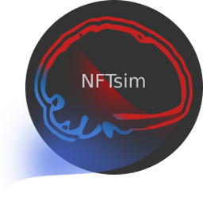

# NFTsim (Neural Field Theory simulator)  

  

NFTsim is written in C++ and implements streamlined standard methods to solve hyperbolic partial differential equations such as the damped 2D wave equation; time stepping methods to solve ordinary differential equations; and procedures for delay differential equations. Careful numerical analysis has resulted in a suite of methods that is fast, accurate, and robust. Thus the present work obviates the need for users to become familiar with all these techniques and underlying theory, program them, and then debug several thousand lines of code. The code has been tailored to use these state equations to solve an unlimited number of user-defined continuum neural field models. The input and output files are both plain-text, so NFTsim can be easily integrated into existing workflows and analyses written in other programming languages.
NFTsim comes with a collection of custom made Matlab functions that allow for an easy access to the compiled code, for users without prior knowledge of C++. End-users need only to write plain text files as described in the User Manual.

## Installation

1. Fork and clone; or,

2. download the latest [release](https://github.com/BrainDynamicsUSYD/nftsim/releases) as a `.zip` or `tar.gz` file and extract the folder.

3. After doing 1) or 2) type `cd nftsim`.

## Requirements

+ **Compilers**: Make sure you have a compiler that supports the `C++11` standard.  
    + On Linux: `gcc` 4.8 or higher; `clang 3.7` or higher. If you have use your own makefile or compile by hand, and have 4.8.1 <= gcc < 5.1.0, the flag `-std=c++11` must be passed to the compiler. 
    + On MacOS: `clang` 3.3 or later version;

+ **Documentation**: To build the developer reference manual you'll need 
    + `doxygen` and,
    + `graphviz`. The latter provides the DOT language.
    + `pdflatex`. The user manual is compiled using `pdflatex` an it is also provided as a pdf (`doc/NFTsimManual.pdf`).

### Compiling and building from the source code

To build the executable on Linux or MacOS, open a terminal in the `nftsim` directory and type:

    make

this produces the executable `bin/nftsim` and autogenerates the documentation. 

To build only the reference manual type:

    make reference-manual

The html files for the reference-manual will be placed under `doc/html`, point your browser at the index.html file in that directory.

For a brief description of available Makefile targets, type:

    make help

Are you on Windows and want to use `NFTsim`. Check [some options here](https://github.com/BrainDynamicsUSYD/nftsim/wiki/All:-Cross-platform-support). 

### Reproducibility of random noise

White-noise stimuli (`White`, `WhiteCoherent`) draw from a 64-bit Mersenne Twister (`std::mt19937_64`) and turn its output into Gaussian variates with Marsaglia's polar method, written out in `src/random.cpp`.
`std::normal_distribution` is not used, because its algorithm differs between standard libraries.
So a given `Ranseed` (or the default seeds 1, 2, 3, ... given to the stimuli in turn) produces the same noise whether `NFTsim` is built with GCC (libstdc++) or clang (libc++), and the same noise (to round-off) as earlier versions built with GCC.
Outputs from different compilers or platforms can still differ by round-off, typically below 1e-12 relative, because compilers may fuse multiply-adds (clang does by default; `-ffp-contract=off` turns this off) and maths libraries can differ in the last bit.

## Demos

Example configurations including examples for published results are available in the `configs` folder.

To run the basic example type

    ./bin/nftsim -i ./configs/eirs-corticothalamic.conf -o eirs-corticothalamic.output

## Time-stepping scheme

By default `NFTsim` advances the coupled model with a scheme that is first order in `Deltat`: halving the time-step halves the error.
An optional second-order scheme, where halving `Deltat` quarters the error, is selected by adding a line after `Time: ... Deltat: ...` in the configuration file:

    Time: 10 Deltat: 1.220703125e-04
    Integration: SecondOrder

Without this line (or with `Integration: Default`) the output is unchanged.

The second-order scheme changes three things:

- each dendrite takes its input `nu*phi` as linear over the time-step, extrapolated from its two most recent values, instead of holding it constant;
- the `Harmonic` propagator takes the delayed firing rate `Q` as linear between its values at the start and end of the step (as `HarmonicIntegral` and `Wave` already do);
- a delay `Tau` that is not a whole number of time-steps is interpolated linearly between the stored firing rates instead of being rounded to the nearest step.

No extra solves are needed, so it runs as fast as the default scheme.

Use it whenever accuracy matters at the usual time-steps (`Deltat` around 1e-4 s).
For a single-node corticothalamic model, the error in the response to a smooth pulse at `Deltat` = 2^-13 s is about 0.3% with `SecondOrder`, against 5% (RK4 dendrites) or 18% (Integral dendrites) with the default scheme.
At that time-step the default scheme also overestimates the spindle peak power of `test/numerical/eirs-spindles.conf` by about 10%.
The second-order scheme also removes the error from rounding delays: with the default scheme a delay of 42 ms is rounded to a whole number of steps, which stops the error falling below about 2% as `Deltat` is reduced.

Second order needs smooth inputs.
A stimulus that jumps (`PulseRect`, `Burst`) gives first-order errors near each jump with either scheme, and white noise converges only in its statistics (spectra), not path by path.
Modules that integrate their own state with their inputs held constant over a step are still first order: the plastic couplings (`CaDP`, `BCM`, `BCM-Spatial`), the `Bursting` and `GlutamateResponse` firing responses, and `WaveLegacy`.
The `Ramp` and `DiffArctan` couplings evaluate `nu` one step ahead of `phi`, which is first order while `nu` is changing, and `Ramp` dendrites keep their rates constant within a step (evaluated at its midpoint).
The `Wave` propagator's spatial error depends on the grid spacing and is not changed by this option.

## Troubleshooting

Problems compiling? First check [the following page](https://github.com/BrainDynamicsUSYD/nftsim/wiki/All:-Cross-platform-support) for the latest information. If that doesn't solve the problem please drop us a message using Github's issues. Don't forget to mention the following info: operating system, compiler, compiler version, `NFTsim` version. 

## How to contribute code

If you intend to contribute to NFTsim development, please make a private fork of this repository and follow the [instructions for contributors.](https://github.com/BrainDynamicsUSYD/nftsim/wiki/Dev:-How-to-contribute-code-to-NFTsim)

## How to cite `NFTsim`

Liked the code? Did you use it in your research and got awesome results?

Please cite us as follows:
   
   Sanz-Leon, P., Robinson, PA., Knock, SA., Drysdale, PM., Abeysuriya, RG., Fung, FK.,
   Rennie, CJ and Zhao, XL.
   
   _NFTsim: Theory and Simulation of Multiscale Neural Field Dynamics_
   
   PLoS Computational Biology (2018).
   Read the paper [here](http://journals.plos.org/ploscompbiol/article/related?id=10.1371/journal.pcbi.1006387).

Citation metadata are also provided in [`CITATION.cff`](CITATION.cff), which GitHub uses for its "Cite this repository" button.
   

