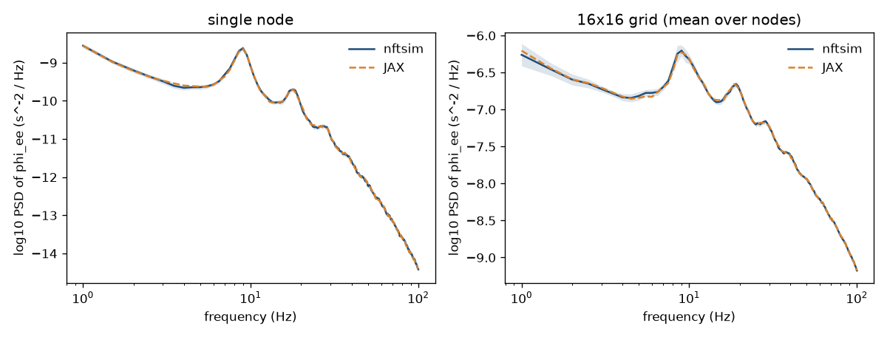

# Prototype: batched, differentiable JAX implementation of the corticothalamic model

**Status: prototype, not for merging as is.**
It exists to answer, with measurements, whether a JAX version of `NFTsim` (on CPU now, GPU later) is worth building for parameter sweeps and model fitting.
Nothing in `src/` is changed.

## What it is

`nftjax` is a small JAX (float64) reimplementation of the part of `NFTsim` that the standard EIRS corticothalamic model uses:

- populations with a sigmoid firing response, and stimulus populations with a constant mean, white noise (`White`, same ASD convention) and a rectangular pulse (`PulseRect`, optionally at chosen nodes);
- `Map` couplings, and dendrites of both kinds: the default RK4 `Dendrite` (input held constant over a step) and `Integral`;
- `Map`, `Harmonic` and `Wave` propagators (the explicit five-point scheme on a periodic grid of any shape; on a single node `Wave` becomes `Harmonic`, as in `NFTsim`);
- delays through a ring buffer of firing rates, rounded to whole steps (default scheme) or interpolated (`Integration: SecondOrder`);
- both time-stepping schemes, `Default` and `SecondOrder`.

The model structure (populations, connections, propagator and dendrite kinds, grid, time-step) is static, and every numerical parameter (`nu`, `alpha`, `beta`, `tau`, `gamma`, `range`, sigmoid parameters, initial rates, stimulus parameters, sheet length) is a leaf of a parameter pytree.
A run is a pure function of that pytree, so `jax.vmap` runs a batch of parameter sets and `jax.grad` differentiates through a whole simulation.

## Contents

| path | what |
|---|---|
| `nftjax/model.py` | the model: `Spec`, `init_state`, `make_step`, `simulate`, `batch_simulate`, `steady_state` |
| `nftjax/eirs.py` | the EIRS model: its spec, parameters (`params`, `batch_params`), and an `NFTsim` `.conf` writer |
| `nftjax/nftsim_io.py` | runs the `nftsim` executable and reads its `.output` |
| `nftjax/compare.py` | the deterministic comparison cases |
| `nftjax/spectra.py` | Welch power spectra in JAX (differentiable) |
| `nftjax/parallel.py` | splits a batch over devices (CPU cores or GPUs) with `shard_map` |
| `scripts/validate.py` | JAX vs `NFTsim` on deterministic configurations |
| `scripts/noise_spectra.py` | JAX vs `NFTsim` power spectra of noise-driven runs |
| `scripts/benchmark.py`, `scripts/summarise.py` | throughput against `NFTsim` run as separate processes |
| `scripts/gradcheck.py` | `jax.grad` against finite differences |
| `scripts/gpu_estimate.py` | rough H100 estimate from XLA's cost analysis |
| `gpu/` | setup and PBS job for the physics cluster's H100 |
| `tests/` | pytest tests, run in CI by `.github/workflows/prototype-jax.yml` |
| `results/` | the measurements quoted below |

## How to run

From the repository root:

    make -j8 nftsim                       # the reference executable, bin/nftsim
    python3 -m venv ~/jaxenv && ~/jaxenv/bin/pip install -r prototypes/jax/requirements.txt matplotlib
    cd prototypes/jax
    ~/jaxenv/bin/python -m pytest tests   # about 15 s
    ~/jaxenv/bin/python scripts/validate.py
    ~/jaxenv/bin/python scripts/noise_spectra.py
    ~/jaxenv/bin/python scripts/gradcheck.py
    ~/jaxenv/bin/python scripts/benchmark.py --model node
    ~/jaxenv/bin/python scripts/benchmark.py --model grid
    ~/jaxenv/bin/python scripts/summarise.py results/bench_*.json

A minimal use:

```python
import numpy as np
from nftjax import eirs, simulate, batch_simulate

sp = eirs.spec(noise=True)                       # single node, white-noise drive
p = eirs.params()                                # the eyes-closed parameters
phi = simulate(sp, p, n_steps=8192, out_every=8,
               record=lambda st: st["phi"][0])   # phi_ee, 1 s at 1024 Hz

nus = np.array(eirs.NU) * np.random.default_rng(0).uniform(0.995, 1.005, (512, 11))
out = batch_simulate(sp, eirs.batch_params(512, nu=nus), 8192, 8,
                     record=lambda st: st["phi"][0], layout="nodes")  # (512, 1024, 1)
```

## Design

One step follows `src/solver.cpp`: couplings (`P = nu*phi`, with the previous step's `phi`), then populations (dendrites, soma potential, firing rate, written to the ring buffer), then propagators (with the firing rates just computed).
Every floating-point expression is written in the order of the C++ code (eg the sum of a population's dendrites runs in connection order), and the parameters reach `NFTsim` through `repr()`, which round-trips exactly, so the two start from identical numbers.

Time is a `lax.scan` over output blocks, each a `lax.scan` over `out_every` steps; with `checkpoint=True` each block is rematerialised in the backward pass, so reverse-mode memory scales with the number of outputs rather than of steps.
The white-noise variates of a block are drawn at once, outside the inner loop.

Batches run in one of two layouts.
`layout="vmap"` maps the simulation over the batch with `jax.vmap`, so arrays are `(batch, ..., nodes)`; this is the one used for grids.
For a single node, `layout="nodes"` instead runs the batch as the nodes of one uncoupled simulation with per-node parameters, which puts the batch on the contiguous axis and is about twice as fast on CPU (the two layouts give the same numbers to 1e-13; tested).
On CPU, XLA runs a step on one thread, so `nftjax.parallel` splits the batch over several CPU devices (`XLA_FLAGS=--xla_force_host_platform_device_count=N`), one thread each.

Not implemented: other firing responses, plastic couplings, `WaveLegacy`, `HarmonicIntegral`, nonperiodic boundaries, the other stimuli, and `alpha == beta` in `Integral` dendrites.
Each is a local addition in the same style.

## Validation against NFTsim

### Deterministic runs

`scripts/validate.py` builds `NFTsim` configurations from the EIRS model (`test/numerical/eirs-dendrite-integral.conf` with the `White` stimulus replaced by a constant drive plus a `PulseRect` of 32 steps, everywhere on a single node and at node 6 on a grid), runs both codes, and compares every trace (`phi` of the 11 propagators and `Q` of the 5 populations, at every node and step) as max|JAX − NFTsim| / max|NFTsim|.
The cases cover both dendrite kinds, both schemes, square and rectangular grids, and delays that are and are not whole numbers of steps.
Results for 8192 steps (1 s), `results/validate.md`:

| case | JAX vs NFTsim | NFTsim vs NFTsim built with `FPFLAGS=-ffp-contract=off` |
|---|---|---|
| single node, RK4 dendrites | 3.4e-15 | 6.2e-15 |
| single node, Integral dendrites | 9.7e-14 | 3.0e-14 |
| single node, RK4, SecondOrder, t0/2 = 348.6 steps | 3.7e-15 | 5.2e-15 |
| single node, Integral, SecondOrder, t0/2 = 348.6 steps | 8.9e-14 | 2.5e-14 |
| 4x4 grid, RK4 | 7.8e-14 | 4.7e-13 |
| 8x8 grid, Integral | 6.7e-14 | 3.1e-13 |
| 6x4 grid (rectangular), RK4, SecondOrder, t0/2 = 344.1 steps | 7.5e-14 | 3.0e-13 |
| 8x8 grid, Integral, SecondOrder, t0/2 = 348.6 steps | 1.1e-13 | 3.4e-13 |

The agreement is round-off: 3e-15 to 1e-13 relative, the same size as the difference between two `NFTsim` builds that differ only in whether the compiler fuses multiply-adds (on the grids the JAX model is closer to the default `NFTsim` build than the two builds are to each other).
The residual comes from fused multiply-adds (XLA and clang fuse different operations), from XLA's `exp` (within 2 ulp of libm's), and from the output's 14 significant digits, amplified by the model's own gain: the largest differences are in the strongly driven traces of the Integral-dendrite runs, where the relay-nucleus firing rate reaches 67 s^-1 on the steep part of the sigmoid.
The tests run these cases for 1024 steps with nf_numerical's tolerance (1e-9), and check that recording every 8 steps matches `NFTsim`'s `Interval`.

### Noise-driven runs

`scripts/noise_spectra.py` compares spectra of `phi_ee` from 16 runs of each code (single node, 32 s each; `NFTsim` with `Ranseed` 1 to 16, JAX with 16 keys) and from 8 runs of a 16x16 grid (8 s each, spectrum averaged over nodes), with Welch estimates at 0.5 Hz resolution from 1 to 100 Hz (`results/noise_spectra.json`, `results/noise_spectra.png`).

| | mean PSD ratio JAX/NFTsim, 1-100 Hz | alpha (8-13 Hz) power ratio | rms log10 ratio | bins with \|z\| > 2 | peak |
|---|---|---|---|---|---|
| single node | 1.0005 | 0.97 | 0.028 | 4.5% | 9.0 Hz in both |
| 16x16 grid | 1.0011 | 0.98 | 0.013 | 8.5% | 9.0 Hz in both |

Here z is the difference of the mean log spectra over its standard error; under the null about 5% of bins exceed 2, and neighbouring bins are correlated (Hann window), so these are consistent with identical spectra.
This also confirms the `White` ASD convention, including its grid factor 2(2π)^2/Δx^2: an error in the convention would shift the spectra by a constant factor (a factor of 2 is 0.3 in log10).



## Performance

### CPU (measured)

`scripts/benchmark.py` times the noise-driven EIRS model (each `nu` perturbed by up to 0.5% per parameter set, recording `phi_ee` at one node every 8 steps) as simulated seconds per wall-clock second, summed over the batch.
`NFTsim` (default `make` build, `-O3 -flto -march=native`) runs as B separate processes launched by `xargs`, at most 10 at a time (one per core); JAX splits the batch over up to 8 CPU devices (the largest power of two ≤ 10 that divides the batch), one thread each, and compilation is excluded (it is paid once per batch shape: 0.3-1.7 s).
Machine: Apple M1 Pro (8 performance + 2 efficiency cores, 16 GB), JAX 0.12.0.1.
**The machine was shared with other jobs during these runs (load average 9-21 on 10 cores), so absolute numbers are low and somewhat noisy**; both arms ran back to back under the same load, and the ratios are the meaningful part.
Results in `results/bench_*_cpu.json` and `results/bench_cpu_summary.md`.

Single node, 10 s simulated per parameter set:

| batch | JAX (sim-s/s) | NFTsim (sim-s/s) | JAX / NFTsim |
|---|---|---|---|
| 1 | 750 | 84 | 8.9 |
| 8 | 4,194 | 364 | 12 |
| 64 | 6,679 | 443 | 15 |
| 512 | 8,184 | 427 | 19 |
| 4096 | 6,661 | 427 | 16 |

32x32 grid (Wave propagators, 0.5 m sheet), 0.25 s simulated per parameter set:

| batch | JAX (sim-s/s) | NFTsim (sim-s/s) | JAX / NFTsim |
|---|---|---|---|
| 1 | 0.92 | 1.27 | 0.73 |
| 8 | 7.1 | 10.0 | 0.71 |
| 64 | 5.8 | 9.7 | 0.60 |
| 512 | 6.1 | 10.7 | 0.57 |
| 4096 | 5.8 | 10.4 | 0.56 |

Crossover:

- **Single node: there is no crossover; JAX is faster at every batch size**, 9x for one parameter set and 15-19x for batches of 64 or more.
  `NFTsim` spends about 1.4 µs per step on one node, mostly per-object overhead (eleven dendrites, eleven propagators and five populations, each looping over a vector of length 1), whereas XLA vectorises a step over the whole batch.
  Counting compilation (0.3 s for one set, up to 1.7 s for large batches), JAX is ahead once a batch amounts to more than about 30 simulated seconds.
- **32x32 grid: JAX on CPU is 0.56-0.73x as fast as NFTsim**, so no crossover on CPU.
  Per core and per set the two are close (115 µs against about 95 µs per step for one set), but here the work per step is already 1024 nodes, so batching adds no vectorisation, and running more than about 8 sets per device at once overflows the cache (the grid runs use chunks of 8 sets per device for that reason).
  On CPU a grid step costs about 35% for the white noise (threefry and an inverse-erf transform in float64, about 34 ns per variate) and 25% for the four Wave propagators.

### GPU (estimated, not measured)

No GPU was used for this prototype.
`scripts/gpu_estimate.py` estimates H100 throughput from XLA's cost analysis of one step, as t_step = kernels × t_launch + bytes / bandwidth, with 2-5 µs per kernel launch (with and without XLA's CUDA-graph command buffers), 2.5 TB/s effective bandwidth (65% of the H100 NVL's 3.9 TB/s), and the ring buffer counted as the rows it actually touches.
Float64 arithmetic (about 1.1-1.4 kflop per node per step) is far below the H100's float64 peak and is ignored.
**These are estimates only** (`results/gpu_estimate.md`):

| model | batch | est. step time | est. H100 throughput (sim-s/s) | measured CPU: JAX, NFTsim |
|---|---|---|---|---|
| single node | 64 | 36-90 µs | 90-220 | 6,679, 443 |
| single node | 4096 | 39-93 µs | 5,400-13,000 | 6,661, 427 |
| single node | 32768 | 62-116 µs | 34,000-64,000 | - |
| single node | 262144 | 245-299 µs | 107,000-131,000 | - |
| 32x32 grid | 8 | 117-270 µs | 3.6-8.4 | 7.1, 10.0 |
| 32x32 grid | 64 | 222-375 µs | 21-35 | 5.8, 9.7 |
| 32x32 grid | 512 | 1.1-1.2 ms | 51-59 | 6.1, 10.7 |
| 32x32 grid | 4096 | 7.8-7.9 ms | 63-64 | 5.8, 10.4 |

The pattern is the usual one for a time-stepped model on a GPU: each step is a few dozen small kernels, so below about 10^4 single-node sets (or about 64 grids) the GPU is launch-bound and no faster than the CPU.
With enough parallel work it should reach about 10^5 simulated s/s for single-node sweeps (15-20x JAX on this CPU, 250-300x `NFTsim` on 10 cores) and about 60 simulated s/s for 32x32 grids (about 6x `NFTsim` on 10 cores, 10x JAX on CPU).
The byte counts from XLA's cost analysis are probably pessimistic for the grid (XLA counts each roll of a field as a fresh read), so the grid estimate may be low by up to a factor of 2-3; the launch overhead is the main uncertainty for the single node.

## Differentiability

`scripts/gradcheck.py` differentiates two losses with respect to θ = (`nu_ee`, `nu_ei`, `t0`) (Couplings 1 and 2, and the corticothalamic loop delay; each of the four corticothalamic delays is t0/2), with `jax.grad` through the whole simulation, and compares with central finite differences (Richardson-extrapolated; the best of relative steps 1e-3 to 1e-7, since finite differences are limited by truncation at large steps and round-off at small ones).
It uses the `SecondOrder` scheme, which interpolates fractional delays, so that the output depends smoothly on `t0`; with the default scheme delays are rounded to whole steps and the gradient in `t0` is zero.
Each run starts at the steady state of its own parameters (`steady_state()`, Newton's method, differentiable), because a fixed initial `Q` starts a transient whenever the parameters change.
At these near-critical eyes-closed parameters (a 1% rise in `nu_ee` moves the steady relay-nucleus rate from 8.8 to 16 s^-1) that transient otherwise dominates the gradient of a short run.

Results (`results/gradcheck.json`; relative difference between `jax.grad` and the best finite difference):

| loss | nu_ee | nu_ei | t0 | reverse-mode cost / forward | forward-mode cost / forward |
|---|---|---|---|---|---|
| trace, 1 s, pulse | 5e-12 | 1e-10 | 6e-10 | 19 | 3.2 |
| alpha power, 1 s, noise | 1e-9 | 3e-8 | 2e-7 | 15 | 2.8 |
| alpha power, 4 s, noise | 5e-8 | 2e-8 | 1e-7 | 16 | 2.8 |
| alpha power, 16 s, noise | 2e-8 | 6e-10 | 3e-8 | 17 | 2.9 |
| alpha power, 64 s (524,288 steps), noise | 7e-9 | 1e-8 | 3e-8 | 17 | 2.9 |

Forward mode (`jax.jacfwd`) agrees with reverse mode to 1e-10 or better.

Numerical stability over long runs: at these parameters the model is linearly stable (noise-driven fluctuations about a fixed point), so the adjoint is damped as well and the gradients stay finite and accurate out to 64 s; the `nu` gradients of the alpha-power loss converge as the run lengthens (-1.51e4, -1.58e4, -1.64e4, -1.69e4 for `nu_ee` at 1, 4, 16, 64 s), while the `t0` gradient is small and varies in sign with the noise realisation, which is a property of the loss rather than of the numerics.
Two cautions for fitting follow.
Gradients of trajectory losses grow exponentially with run length wherever the dynamics are unstable or chaotic (limit cycles, seizure-like regimes), so losses there should be statistical (spectra) rather than pointwise.
Near the stability boundary (as for these eyes-closed parameters) the loss surface is steep, so runs should start from each parameter set's own steady state, as here.

Cost: reverse mode (`jax.grad`, with the time loop checkpointed per output block) costs 15-19 forward runs on CPU, because the adjoint of the delay ring buffer touches the whole buffer at every step; for a handful of parameters forward mode is the better choice at about 3 forward runs.
Batched, 512 parameter sets' reverse-mode gradients of the 4 s alpha-power loss take 27 s on one CPU device (19 gradients/s, 13x the forward cost).
A custom adjoint for the ring buffer (a reversed buffer of cotangents) would bring reverse mode down to the usual 3-5x, and is the main thing to do before fitting many parameters.

## GPU next step

`gpu/physics_h100.pbs` runs the whole set of measurements on the University of Sydney physics cluster's H100 (queue `h100`, one GPU per user, so submit it once): the validation against `NFTsim` with JAX on the GPU, the GPU throughput for single-node batches up to 131,072 and grid batches up to 4096, the gradient checks, and, on the same node with 16 cores, `NFTsim` and CPU JAX, so that both arms of the comparison share hardware.
Everything lives under `/taiji1/bful7291/nftsim-jax` (home is nearly full), and the job needs a few GB of host memory, about 30 GB on the GPU (the largest grid batch), and probably under an hour (walltime is set to 3 h).
It has not been run.

1. Push this branch (already done for the PR), then set up a clone and a uv venv (CPython 3.12, `jax[cuda13]==0.12.0.1`) on the head node:

       ssh physics 'bash -s' < prototypes/jax/gpu/setup_physics.sh

2. Submit (the login shell is tcsh, so commands go through `bash -s`), and record the job id that `qsub` prints:

       ssh physics 'bash -s' <<'EOF'
       cd /taiji1/bful7291/nftsim-jax/nftsim/prototypes/jax && /opt/pbs/bin/qsub gpu/physics_h100.pbs
       EOF

3. When it has finished (`ssh physics 'qstat -x -w <id>'`), fetch the results:

       rsync -av physics:/taiji1/bful7291/nftsim-jax/results/ prototypes/jax/results/h100/

   `summary.md` in that directory has the throughput tables.

If `jax[cuda13]` does not find the GPU (the job stops with "no GPU visible to JAX"), install `jax[cuda12]==0.12.0.1` instead, which the CUDA 13 driver also runs.

## Recommendation

**Yes for parameter sweeps and fitting of single-node (and few-node) models; not yet for spatial grids on CPU; the GPU case for grids rests on an estimate and should be measured with the job above before committing to it.**

- Correctness is not the risk: the JAX model reproduces `NFTsim` to round-off (≤1e-13), and its noise-driven spectra are statistically indistinguishable.
- Single-node sweeps are 9-19x faster on the same CPU, and the GPU should add another order of magnitude at batches of 10^4-10^5.
  This is the common use (fitting EEG spectra), and it is available now.
- Gradients through whole simulations are exact (to 1e-7 against finite differences, out to 64 s) and cheap in forward mode (3 forward runs for 3 parameters), which makes gradient-based fitting of spectra practical, something `NFTsim` cannot offer.
- 32x32 grids on CPU are 0.6-0.7x `NFTsim`'s speed, so a JAX version only pays for grids with a GPU (estimated about 6x `NFTsim` on 10 cores) or when gradients are needed.

Suggested path: keep `NFTsim` as the reference and general-purpose engine, and build a JAX companion covering the models people fit (EIRS-type models with the current propagators, dendrites and stimuli), validated against `NFTsim` in CI as this prototype is.
Before that, run the H100 job, write the custom adjoint for the delay buffer, and decide whether the parameter interface should be generated from `.conf` files (a reader, rather than this prototype's hand-written EIRS spec).
